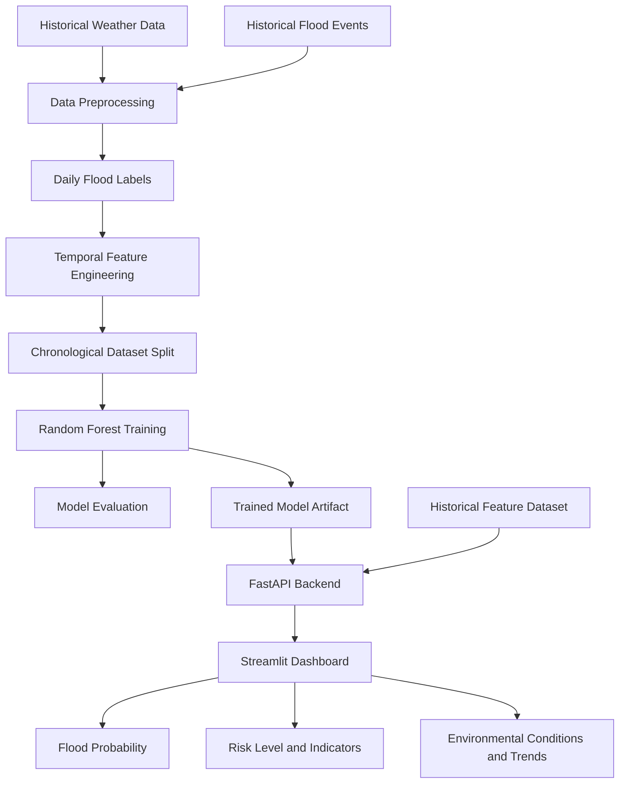
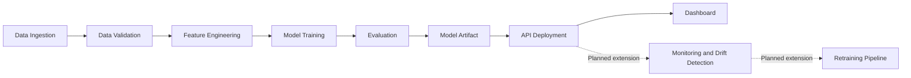

# FloodGuard 🌊
### Intelligent Urban Flood Prediction & Early Warning System

FloodGuard is a machine learning-based urban flood-risk prediction system that analyzes historical weather patterns and flood-event data to estimate the likelihood of a flood occurring within the next three days. It combines data ingestion, temporal feature engineering, a Random Forest classification model, a FastAPI prediction service, and an interactive Streamlit dashboard.

The project demonstrates an end-to-end machine learning workflow with an MLOps-oriented architecture for model evaluation, deployment, monitoring, drift detection, and future retraining.

> **Project status:** Working machine learning prototype with a functional prediction API and interactive dashboard. The current prediction interface uses historical, precomputed feature data; live weather ingestion and production-grade automated MLOps services are future extensions.

---

## Table of Contents

- [FloodGuard 🌊](#floodguard-)
    - [Intelligent Urban Flood Prediction \& Early Warning System](#intelligent-urban-flood-prediction--early-warning-system)
  - [Table of Contents](#table-of-contents)
  - [🌍 Overview](#-overview)
  - [🎥 Project Demo](#-project-demo)
  - [🎯 Problem Statement](#-problem-statement)
  - [🎯 Objectives](#-objectives)
  - [✨ Key Features](#-key-features)
  - [🏗️ System Architecture](#️-system-architecture)
    - [Architecture components](#architecture-components)
  - [🧰 Technology Stack](#-technology-stack)
  - [📊 Dataset and Feature Engineering](#-dataset-and-feature-engineering)
    - [Data sources](#data-sources)
    - [Feature engineering](#feature-engineering)
    - [Prediction target](#prediction-target)
  - [🤖 Machine Learning Model](#-machine-learning-model)
    - [Model configuration](#model-configuration)
    - [Chronological evaluation](#chronological-evaluation)
  - [📈 Model Evaluation](#-model-evaluation)
    - [Interpreting the results](#interpreting-the-results)
  - [📁 Project Structure](#-project-structure)
  - [🚀 Installation and Setup](#-installation-and-setup)
    - [Prerequisites](#prerequisites)
    - [Step 1: Clone the repository](#step-1-clone-the-repository)
    - [Step 2: Create a virtual environment](#step-2-create-a-virtual-environment)
    - [Step 3: Install dependencies](#step-3-install-dependencies)
    - [Step 4: Verify required files](#step-4-verify-required-files)
  - [▶️ Running the Application](#️-running-the-application)
    - [Terminal 1: Start the FastAPI backend](#terminal-1-start-the-fastapi-backend)
    - [Terminal 2: Start the Streamlit dashboard](#terminal-2-start-the-streamlit-dashboard)
    - [Quick-start command summary](#quick-start-command-summary)
  - [🖥️ Using the Dashboard](#️-using-the-dashboard)
  - [🔌 API Documentation](#-api-documentation)
    - [Example prediction request](#example-prediction-request)
    - [Example response](#example-response)
  - [🚦 Understanding the Prediction](#-understanding-the-prediction)
    - [Risk levels](#risk-levels)
    - [Key risk indicators](#key-risk-indicators)
  - [⚙️ MLOps Workflow](#️-mlops-workflow)
    - [Implemented components](#implemented-components)
    - [Planned production extensions](#planned-production-extensions)
  - [⚠️ Limitations](#️-limitations)
  - [🔮 Future Enhancements](#-future-enhancements)
  - [🤝 Contributing](#-contributing)
  - [⚖️ Disclaimer](#️-disclaimer)

---

## 🌍 Overview

Urban flooding is a major challenge for cities, particularly during periods of persistent or intense rainfall. Identifying elevated flood risk requires analyzing more than a single day's weather conditions.

FloodGuard uses historical weather observations, rainfall patterns, environmental variables, and historical flood records to build a machine learning model that estimates the probability of a flood event occurring within the following three days.

The system converts the model output into an understandable risk assessment and displays the result through an interactive dashboard.

**The central idea is simple:**

**Environmental Data → Feature Engineering → Machine Learning → Flood-Risk Prediction → Interactive Dashboard**

The current implementation focuses on Chennai, India, and serves as a foundation for developing a more comprehensive urban flood-intelligence platform.

## 🎥 Project Demo

Watch the complete FloodGuard project demonstration to see the FastAPI prediction service, the interactive Streamlit dashboard, and the flood-risk assessment workflow in action.

▶️ **[Watch the FloodGuard Demo Video](https://drive.google.com/file/d/1LX_Z0WzV0_ZhyUXqyFXawvIKTWNJuKyA/view?usp=sharing)**

*The demo showcases the project workflow, environmental indicators, flood-risk predictions, and dashboard visualizations.*

## 🎯 Problem Statement

Conventional weather observations do not directly communicate the probability of an urban flood. Rainfall accumulation, prolonged wet conditions, humidity, seasonal patterns, and other environmental variables can interact in complex ways.

FloodGuard addresses this problem by:

- Analyzing historical weather and flood-event records.
- Engineering temporal features that represent recent and accumulated environmental conditions.
- Training a supervised machine learning model to estimate flood risk.
- Exposing predictions through a REST API.
- Presenting probabilities, risk levels, environmental measurements, and risk indicators in a dashboard.

## 🎯 Objectives

1. Collect and prepare historical weather and flood-event data.
2. Generate daily flood labels from historical flood records.
3. Engineer meaningful temporal and environmental features.
4. Train and evaluate a Random Forest classifier using chronological data splits.
5. Serve predictions through a FastAPI backend.
6. Build an interactive Streamlit dashboard for flood-risk assessment.
7. Establish an extensible architecture for monitoring, drift detection, and model retraining.

## ✨ Key Features

| Feature | Description |
|---|---|
| Three-day flood-risk forecast | Estimates whether a flood event may occur within the next three days. |
| Probability estimation | Returns the model's estimated probability for the positive class. |
| Risk classification | Displays low, moderate, or high risk using configured probability thresholds. |
| Environmental conditions | Displays rainfall, mean temperature, relative humidity, and wind speed. |
| Key risk indicators | Highlights selected rainfall, humidity, and persistent-rainfall conditions. |
| Rainfall trend visualization | Shows recent rainfall patterns associated with the selected analysis date. |
| Prediction summary | Consolidates the date, location, forecast horizon, model, probability, and risk level. |
| REST API | Provides prediction, health-check, and model-information endpoints. |
| MLOps-oriented design | Organizes data processing, model artifacts, evaluation, serving, and planned monitoring extensions. |

## 🏗️ System Architecture

The implemented application follows this high-level architecture:



### Architecture components

**1. Data ingestion**

Collects historical weather observations and flood-event records for data preparation and model development.

**2. Preprocessing and feature engineering**

Cleans and combines the relevant data, creates daily flood labels, and calculates temporal features.

**3. Model training and evaluation**

Trains a Random Forest classifier and evaluates its performance using chronological training, validation, and test periods.

**4. Model serving**

FastAPI loads the trained model and exposes HTTP endpoints for health checks, model information, and prediction requests.

**5. User interface**

Streamlit communicates with the FastAPI service and displays the prediction results through an interactive dashboard.

**6. MLOps extensions**

Monitoring, data-drift detection, experiment tracking, and automated retraining are planned extensions of the architecture. They should not be interpreted as fully operational services in the current prototype.

## 🧰 Technology Stack

| Technology | Purpose |
|---|---|
| Python | Core programming language |
| Pandas and NumPy | Data manipulation and numerical operations |
| Scikit-learn | Machine learning model training and evaluation |
| Random Forest Classifier | Flood-risk probability estimation |
| Joblib | Saving and loading the trained model |
| FastAPI | Prediction API and backend serving |
| Uvicorn | Running the API server |
| Streamlit | Interactive dashboard |
| Matplotlib / Streamlit charting | Data visualization, where used |
| Git and GitHub | Version control and project hosting |

The architecture can be extended with MLflow, DVC, Docker, GitHub Actions, Airflow, Prometheus, Grafana, Evidently, and SHAP as implementation requirements evolve.

## 📊 Dataset and Feature Engineering

### Data sources

The project uses historical weather observations for Chennai spanning **2010–2025**, together with historical flood-event information used to construct supervised learning labels.

Weather variables include:

- Rainfall in millimetres.
- Maximum, minimum, and mean temperature.
- Relative humidity.
- Maximum wind speed.
- Date and seasonal information.

The project also contains a flood-event dataset and processed daily flood labels.

### Feature engineering

The model uses **52 engineered features** covering environmental conditions, temporal patterns, and recent rainfall history.

Examples include:

| Feature | Meaning |
|---|---|
| `rainfall_mm` | Rainfall recorded for the relevant day |
| `rainfall_3d_sum` | Rainfall accumulation over a three-day window |
| `rainfall_7d_sum` | Rainfall accumulation over a seven-day window |
| `rainfall_14d_sum` | Rainfall accumulation over a fourteen-day window |
| `rainfall_7d_max` | Maximum daily rainfall within a seven-day window |
| `heavy_rain_days_14d` | Count of heavy-rainfall days over a fourteen-day window |
| `consecutive_rainy_days` | Length of a consecutive rainy period |
| `humidity_7d_mean` | Average relative humidity over a seven-day window |
| `temperature_lag_1d` | Previous day's temperature |
| `northeast_monsoon` | Indicator for the northeast monsoon period |

These features help the model represent persistent rainfall and environmental patterns instead of relying exclusively on a single day's observations.

### Prediction target

The primary target is:

**Flood occurrence within the next three days.**

For an analysis date \(t\), the target is positive if at least one of the next three daily observations is labelled as a flood day:

\[
y_t = \mathbb{1}\left[
y_{t+1}=1 \lor y_{t+2}=1 \lor y_{t+3}=1
\right]
\]

This is a three-day episode-risk target, not a prediction of the exact time a flood will begin. Overlapping positive windows can occur during prolonged flood events.

## 🤖 Machine Learning Model

FloodGuard uses a **Random Forest Classifier**.

Random Forest combines predictions from multiple decision trees. It is useful for learning nonlinear relationships between environmental variables and producing class-probability estimates.

### Model configuration

The saved three-day model was trained with the following configuration:

| Parameter | Value |
|---|---:|
| Algorithm | Random Forest Classifier |
| Number of trees | 500 |
| Maximum tree depth | 12 |
| Minimum samples per leaf | 2 |
| Minimum samples to split | 4 |
| Class weighting | `balanced_subsample` |
| Random state | 42 |
| Number of input features | 52 |

### Chronological evaluation

The data is split chronologically rather than randomly shuffled:

| Dataset | Period |
|---|---|
| Training | 2010–2018 |
| Validation | 2019–2020 |
| Test | 2021–2022 |

This helps evaluate the model on later periods without training it on observations from the future relative to those periods.

## 📈 Model Evaluation

The saved three-day model was evaluated on a test set of 730 observations, including 24 positive cases.

| Metric | Test result |
|---|---:|
| ROC-AUC | 0.8915 |
| PR-AUC | 0.2520 |
| Precision at threshold 0.50 | 0.2778 |
| Recall at threshold 0.50 | 0.2083 |
| F1-score at threshold 0.50 | 0.2381 |

### Interpreting the results

- **ROC-AUC** measures the model's ability to rank positive cases above negative cases across classification thresholds.
- **PR-AUC** summarizes the precision–recall trade-off and is particularly useful when positive cases are rare.
- **Precision** measures the proportion of predicted positive cases that are actually positive.
- **Recall** measures the proportion of actual positive cases identified by the model.
- **F1-score** combines precision and recall.

The dataset is highly imbalanced, and the results show that further work is needed to improve detection performance. A high ROC-AUC does not, by itself, establish that the model is reliable as an operational flood-warning system.

The displayed risk thresholds are application-level rules and should not be interpreted as calibrated real-world flood probabilities.

## 📁 Project Structure

The main repository components are organized as follows:

```text
FloodGuard/
│
├── api/
│   └── main.py
│
├── configs/
│   └── config.yaml
│
├── data/
│   ├── raw/
│   │   ├── weather/
│   │   └── flood_events/
│   └── processed/
│       ├── flood_labels/
│       └── ml_dataset/
│
├── frontend/
│   └── app.py
│
├── models/
│   ├── floodguard_3day_random_forest.joblib
│   ├── 3day_model_config.json
│   ├── 3day_training_metrics.csv
│   ├── 3day_feature_importance.csv
│   ├── 3day_test_predictions.csv
│   └── 3day_threshold_analysis.csv
│
├── src/
│   ├── ingestion/
│   ├── preprocessing/
│   ├── training/
│   ├── models/
│   └── utils/
│
├── tests/
├── docs/
├── requirements.txt
├── .gitignore
└── README.md
```

Some generated files and additional training scripts may also be present in the repository. The `.joblib` model and processed three-day feature dataset are required for the current API implementation.

---

## 🚀 Installation and Setup

Follow these steps to run FloodGuard locally on Windows, macOS, or Linux.

### Prerequisites

Install:

- Python 3.10 or later; Python 3.11 is a suitable choice.
- Git, if cloning the repository.
- A terminal such as PowerShell, Command Prompt, or a Unix shell.

The current application does not require API credentials to run its historical prediction demonstration.

### Step 1: Clone the repository

```bash
git clone https://github.com/jeyaguru-j/FloodGuard-AI.git
cd FloodGuard-AI
```

Alternatively, download the repository as a ZIP file and extract it.

### Step 2: Create a virtual environment

**Windows — PowerShell**

```powershell
python -m venv .venv
.\.venv\Scripts\Activate.ps1
```

If PowerShell blocks environment activation, use Command Prompt:

```bat
.venv\Scripts\activate.bat
```

**macOS / Linux**

```bash
python3 -m venv .venv
source .venv/bin/activate
```

### Step 3: Install dependencies

```bash
python -m pip install --upgrade pip
pip install -r requirements.txt
```

The environment must contain the packages used by the application, including:

- `pandas`
- `numpy`
- `scikit-learn`
- `joblib`
- `fastapi`
- `uvicorn`
- `pydantic`
- `streamlit`
- `requests`
- `pyyaml`

### Step 4: Verify required files

Before starting the application, confirm that these files exist:

```text
api/main.py
frontend/app.py
models/floodguard_3day_random_forest.joblib
data/processed/ml_dataset/chennai_flood_3day_ml_dataset.csv
requirements.txt
```

**Important:** The API loads the trained model and historical feature dataset from these paths. If the model or processed dataset is missing from your downloaded repository, the API will not start successfully. These artifacts must be obtained from the project owner or generated by running the appropriate data-preparation and training scripts.

---

## ▶️ Running the Application

FloodGuard consists of two services: the FastAPI backend and the Streamlit dashboard. Run them in **two separate terminals**.

### Terminal 1: Start the FastAPI backend

From the project root, with the virtual environment activated:

```bash
uvicorn api.main:app --reload
```

The backend should be available at:

- API root: http://127.0.0.1:8000/
- Health check: http://127.0.0.1:8000/health
- Model information: http://127.0.0.1:8000/model-info
- Interactive API documentation: http://127.0.0.1:8000/docs

Check the health endpoint first. It should report a healthy service, a loaded model, and 52 model features.

Keep this terminal running.

### Terminal 2: Start the Streamlit dashboard

Open a second terminal, navigate to the project root, and activate the same virtual environment.

Then run:

```bash
streamlit run frontend/app.py
```

Streamlit will display the local URL, normally:

http://localhost:8501

Open that URL in your browser.

Keep both services running while using the dashboard.

### Quick-start command summary

| Terminal | Command | Purpose |
|---|---|---|
| 1 | `uvicorn api.main:app --reload` | Start the prediction API |
| 2 | `streamlit run frontend/app.py` | Start the dashboard |

---

## 🖥️ Using the Dashboard

Once both services are running:

1. Open the FloodGuard dashboard at `http://localhost:8501`.
2. Select an analysis date using the date selector.
3. Click **Analyze Flood Risk**.
4. Review the estimated flood probability and risk level.
5. Inspect the environmental conditions associated with the selected date.
6. Review the key risk indicators and rainfall trend.
7. View the prediction summary for the selected date.

The current API uses a precomputed historical feature row for the selected date. Only dates available in the processed dataset can be evaluated by this implementation.

The dashboard is therefore a demonstration of historical flood-risk inference, not a live forecast generated from newly fetched weather data.

## 🔌 API Documentation

The FastAPI backend exposes the following endpoints.

| Method | Endpoint | Description |
|---|---|---|
| `GET` | `/` | Basic service information |
| `GET` | `/health` | Checks API and model availability |
| `GET` | `/model-info` | Returns model details and expected features |
| `POST` | `/predict` | Generates a flood-risk prediction for a supported date |

### Example prediction request

Endpoint:

```http
POST http://127.0.0.1:8000/predict
```

Request body:

```json
{
  "date": "2021-11-05"
}
```

You can submit this request using the interactive interface at:

http://127.0.0.1:8000/docs

### Example response

For the sample date above, the saved model and feature dataset previously returned a response similar to the following:

```json
{
  "date": "2021-11-05",
  "location": "Chennai",
  "forecast": "Flood risk within next 3 days",
  "flood_probability": 0.6707,
  "flood_probability_percent": 67.07,
  "risk_level": "HIGH",
  "prediction": 1,
  "key_indicators": [
    "High accumulated rainfall over the previous 14 days",
    "Elevated 7-day rainfall",
    "High average humidity",
    "Persistent rainy conditions"
  ],
  "weather": {
    "rainfall_mm": 26.0,
    "temperature_mean_c": 25.0,
    "humidity_percent": 90.0,
    "wind_speed_kmh": 12.9
  }
}
```

This is an example of the previously observed output. Actual output depends on the model artifact and feature dataset being used.

## 🚦 Understanding the Prediction

### Risk levels

The current application uses the following probability thresholds:

| Probability | Displayed risk level |
|---|---|
| Below 25% | LOW |
| 25% to below 50% | MODERATE |
| 50% or above | HIGH |

The binary prediction is positive at a probability threshold of 0.50.

These thresholds are configurable in the application code. They are demonstration rules, not official meteorological warning categories.

### Key risk indicators

The backend checks selected environmental features against predefined conditions to generate readable indicators. Examples include:

- High accumulated rainfall over the previous fourteen days.
- Elevated rainfall over the previous seven days.
- High average humidity.
- Persistent rainy conditions.

These indicators are rule-based summaries of selected environmental conditions. They are **not SHAP explanations** and do not establish that an individual feature caused the model's prediction.

---

## ⚙️ MLOps Workflow

FloodGuard is organized around an MLOps-oriented lifecycle.



### Implemented components

- Historical weather and flood-event data preparation.
- Daily flood-label generation.
- Temporal feature engineering.
- Random Forest model training and evaluation.
- Saved model and evaluation artifacts.
- FastAPI prediction endpoints.
- Streamlit dashboard integration.

### Planned production extensions

The architecture can be extended with:

- **MLflow:** experiment tracking and model registry.
- **DVC:** dataset and model-artifact versioning.
- **Docker:** reproducible containerized deployment.
- **GitHub Actions:** automated testing and CI/CD.
- **Airflow:** scheduled data pipelines and retraining workflows.
- **Prometheus and Grafana:** service metrics and operational dashboards.
- **Evidently:** data-quality and drift reports.
- **SHAP:** model-prediction explanations.

These are proposed extensions unless their corresponding workflows are explicitly implemented and configured in the repository.

## ⚠️ Limitations

FloodGuard is a research and demonstration prototype. Its current limitations include:

1. **Historical data serving:** The API retrieves precomputed features rather than fetching live weather observations for each prediction.
2. **Geographical scope:** The current implementation focuses on Chennai and should not be assumed to generalize to other cities.
3. **Class imbalance:** The historical dataset contains substantially fewer flood-related observations than non-flood observations.
4. **Limited event coverage:** Historical flood records may not represent all flood events, their severity, or their geographical extent.
5. **Probability calibration:** The predicted score should not be interpreted as a calibrated real-world probability without further validation.
6. **Warning thresholds:** The low, moderate, and high categories are application-level thresholds and require further validation before operational use.
7. **MLOps maturity:** Automated monitoring, drift detection, retraining, and live-data integration require additional implementation.

## 🔮 Future Enhancements

Potential next steps include:

- Integrating live weather forecasts and rainfall observations.
- Incorporating elevation, drainage, land-use, and geographical information.
- Extending predictions to multiple urban regions.
- Improving model calibration and threshold selection.
- Evaluating models with expanding-window time-series validation.
- Adding spatial flood-risk maps and geospatial visualization.
- Implementing automated data-quality checks and drift detection.
- Adding model monitoring, versioning, and scheduled retraining.
- Deploying the application using Docker and cloud infrastructure.
- Developing alert integrations for users and local authorities.

## 🤝 Contributing

Contributions and suggestions are welcome.

1. Fork the repository.
2. Create a feature branch.
3. Make your changes.
4. Test the changes locally.
5. Submit a pull request describing the improvements.

When changing the feature-engineering pipeline or model, ensure that the training and inference feature names and order remain consistent.

## ⚖️ Disclaimer

FloodGuard is an academic and research-oriented prototype intended to demonstrate machine learning-based flood-risk assessment and an MLOps-oriented application architecture.

It is **not an official flood-warning service** and must not be used as the sole basis for emergency, evacuation, infrastructure, or public-safety decisions. Real-world deployment requires live data integration, extensive geographical and hydrological validation, calibrated risk estimates, operational monitoring, and validation by appropriate domain experts.

---

**FloodGuard — Turning Environmental Data into Actionable Flood-Risk Insights.**
